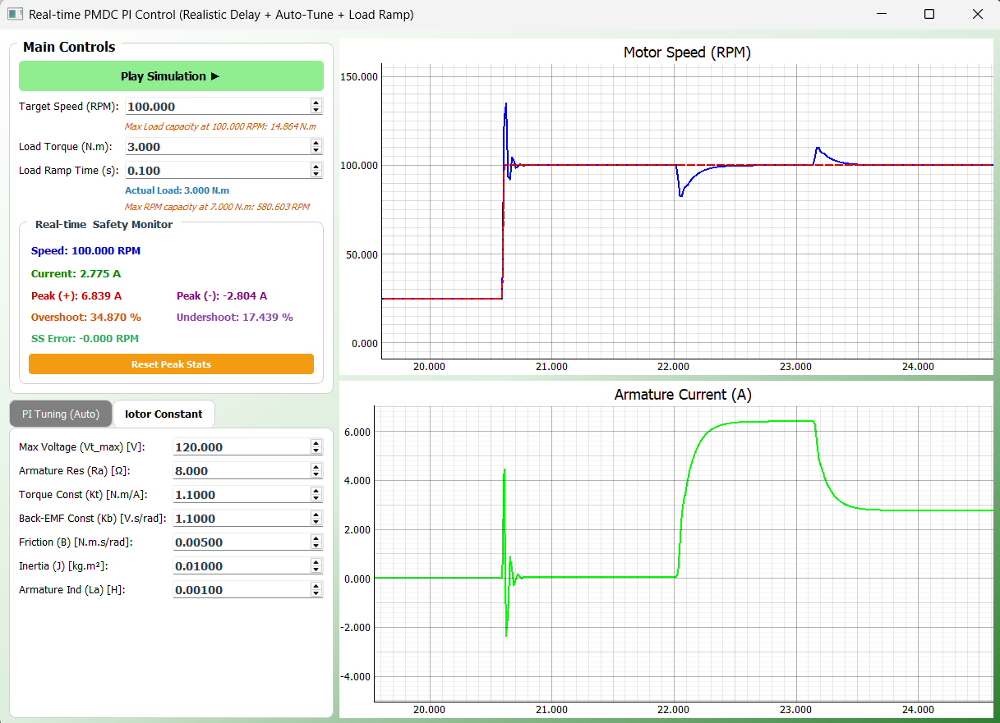

# PMDC Motor PI Control Simulator

A real-time desktop simulator of a **permanent-magnet DC (PMDC) motor** under **PI speed control**, with a built-in **relay-feedback auto-tuner**, a realistic **sensor time delay**, **load-torque ramping** and live performance metrics. Built with Python, PyQt5 and pyqtgraph.



## Features

- **Electromechanical motor model** with armature inductance, resistance, back-EMF, friction and inertia
- **PI speed controller** with output saturation and **clamping anti-windup**
- **Relay-feedback auto-tuning** (modified Ziegler–Nichols) that runs at start-up and whenever the motor constants change
- **10 ms feedback delay** to mimic a real sensor and processing chain
- **Load torque with adjustable ramp time**, to test disturbance rejection smoothly or as a step
- **Live plots** of speed vs. target and armature current (5-second rolling window)
- **Real-time monitor**: speed, current, positive/negative current peaks, overshoot, undershoot and speed error
- **Capacity readouts**: maximum load the motor can carry at the target speed, and maximum speed at the current load
- **Editable motor constants** (supply voltage limit, Ra, La, Kt, Kb, B, J) and PI gains while the simulation runs
- Pause/resume and one-click reset of peak statistics

## How it works

### Motor model

The simulation integrates the standard PMDC equations with the forward Euler method at a step of `Ts = 0.1 ms` (10 kHz):

```
La · dia/dt = Vt − Ra·ia − Kb·ω        (electrical)
Te          = Kt · ia                  (torque)
J · dω/dt   = Te − B·ω − T_load        (mechanical)
```

Speed is clamped at zero (the motor does not reverse), and the shaft stays at rest when the motor torque is below the load torque. Each UI frame (16 ms) advances the model by 160 steps, so the simulation runs in roughly real time.

### Controller

```
e   = ω_target − ω_delayed
Vt  = Kp·e + Ki·∫e dt          clipped to ±Vt_max
```

The speed measurement is delayed by 10 ms (100 simulation steps). When the output saturates, the integrator is only allowed to move in the direction that brings the output back into range (clamping anti-windup).

### Auto-tuning

A relay (on/off) controller is placed around the steady-state voltage for the chosen speed and makes the loop oscillate. From the oscillation the tuner extracts the amplitude `a` and period `Tc`:

```
Ku = 4·d / (π·a)         d = relay amplitude
Kp = 0.35 · Ku
Ki = 0.40 · Ku / Tc
```

The resulting gains are written to the PI tab. The tuner runs on a no-load model and you can still adjust Kp and Ki by hand afterwards.

### Metrics

- **Overshoot** — highest speed above target, as a percentage of target
- **Undershoot** — lowest speed below target, measured only after the speed first reaches 98 % of target, so the start-up ramp is not counted
- **Peak current** — largest positive and negative armature current since the last reset
- **SS Error** — current difference between target and actual speed

## Getting started

### Requirements

- Python 3.11 or newer (the pinned NumPy 2.x needs a recent Python)
- A desktop environment (this is a GUI application)

### Install and run

```bash
git clone https://github.com/<your-username>/pmdc-motor-pi-control-simulator.git
cd pmdc-motor-pi-control-simulator

python -m venv .venv
# Windows:  .venv\Scripts\activate
# macOS/Linux:  source .venv/bin/activate

pip install -r requirements.txt
python main.py
```

## Using the dashboard

| Control | What it does |
| --- | --- |
| **Pause / Play Simulation** | Stops or resumes the physics loop |
| **Target Speed (RPM)** | Speed setpoint; changing it resets the peak statistics |
| **Load Torque (N·m)** | Load applied to the shaft |
| **Load Ramp Time (s)** | Time taken to move from the current load to the new one (0 = instant step) |
| **Reset Peak Stats** | Clears peak current, overshoot and undershoot |
| **PI Tuning tab** | Kp and Ki (set by the auto-tuner, editable) |
| **Motor Constants tab** | Vt_max, Ra, Kt, Kb, B, J, La; changing any value re-runs the auto-tuner |

### Default parameters

| Parameter | Value |
| --- | --- |
| Supply voltage limit `Vt_max` | 6 V |
| Armature resistance `Ra` | 8 Ω |
| Armature inductance `La` | 1 mH |
| Torque constant `Kt` | 1.1 N·m/A |
| Back-EMF constant `Kb` | 1.1 V·s/rad |
| Viscous friction `B` | 0.005 N·m·s/rad |
| Inertia `J` | 0.01 kg·m² |
| Feedback delay | 10 ms |
| Initial target speed | 25 RPM |

## Project structure

```
.
├── main.py            # Motor model, PI controller, auto-tuner and PyQt5 dashboard
├── requirements.txt   # numpy, PyQt5, pyqtgraph
└── README.md
```

## Limitations

- Forward Euler integration; accuracy depends on the small fixed step
- No current limiter, encoder quantisation, noise or temperature effects
- The delay is applied to the speed feedback only
- Auto-tuning assumes a no-load plant and a stable relay oscillation; unusual parameter combinations may leave the previous gains unchanged
- Motor-constant edits re-run the tuner immediately, which can briefly pause the UI

## Ideas for future work

- Export plots and metrics to CSV
- Current-limit and speed-profile (ramp/step sequence) options
- Compare PI, PID and other tuning rules side by side
- Sensor noise and quantisation models
- Unit tests for the physics step and the tuner

## Built with

[Python](https://www.python.org/) · [NumPy](https://numpy.org/) · [PyQt5](https://riverbankcomputing.com/software/pyqt/) · [pyqtgraph](https://www.pyqtgraph.org/)

